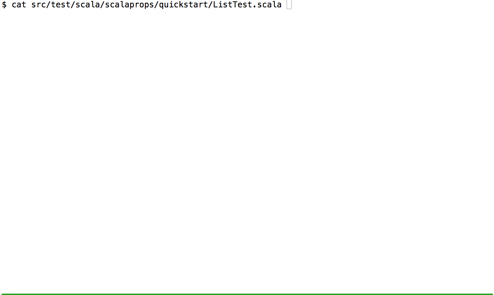

# sbt-scalaprops

sbt plugin for [scalaprops](https://github.com/scalaprops/scalaprops)

sbt-scalaprops provides `scalapropsOnly: InputKey[Unit]` command like `testOnly` but more powerful.
__powerful__ means not only test class names but also test method names and [params](https://github.com/scalaprops/sbt-scalaprops/commit/c50e82740382eac812be2647e3d1d0f2c192e113).

### latest stable version

`project/scalaprops.sbt`

```scala
addSbtPlugin("com.github.scalaprops" % "sbt-scalaprops" % "0.6.0")
```

#### JVM

`build.sbt`

```scala
scalapropsSettings

scalapropsVersion := "0.12.0"
```

or

```scala
scalapropsWithScalaz

scalapropsVersion := "0.12.0"
```

#### Scala.js, scala-native for sbt 1.x

`build.sbt`

```scala
scalapropsCoreSettings

libraryDependencies += "com.github.scalaprops" %%% "scalaprops" % "0.12.0" % "test"
```

or

```scala
scalapropsCoreSettings

val scalapropsVersion = "0.12.0"

libraryDependencies += "com.github.scalaprops" %%% "scalaprops" % scalapropsVersion % "test"
libraryDependencies += "com.github.scalaprops" %%% "scalaprops-scalaz" % scalapropsVersion % "test"
```



